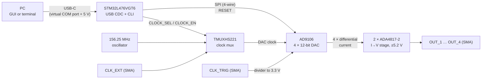
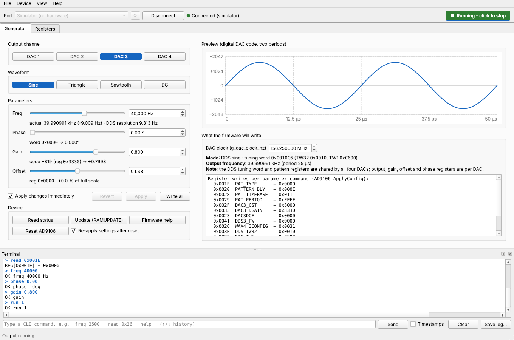
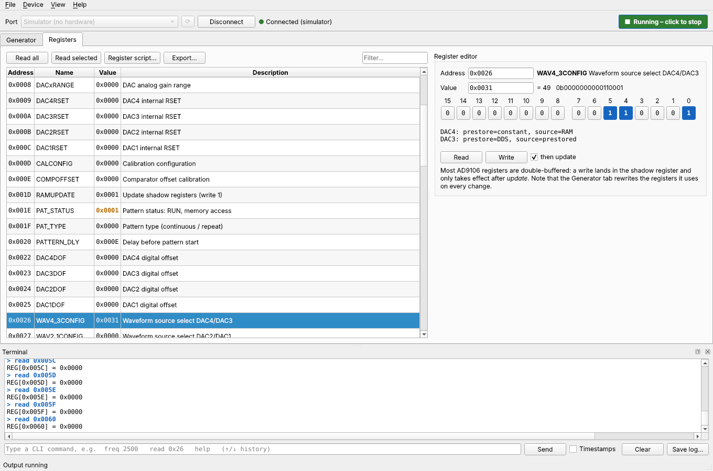

# EFRO Function Generator (AD9106)

A four-channel function generator built around the Analog Devices **AD9106** and an **STM32L476** microcontroller, controlled from a PC over USB. Insyte developed it for the EFRO breast cancer detection project, where it serves as the stimulation module for elastography with the PAM3+ photoacoustic imager.

This repository contains the complete design:

| Part | Folder | Contents |
|---|---|---|
| Hardware | [`Minimal_Prototype_Function_Generator_V0.1/`](Minimal_Prototype_Function_Generator_V0.1) | KiCad schematics and PCB (board revision **V2.0**), production files |
| Firmware | [`Software/`](Software) | STM32CubeMX/CMake project with the AD9106 driver and a USB command-line interface |
| PC software | [`GUI/`](GUI) | Desktop GUI (Python, PySide6) that drives every CLI command |

> The hardware folder still carries its original name (`V0.1`), but the PCB inside it is revision V2.0, as printed on the silkscreen ("Function Generator V2.0").

### Branches

> [!IMPORTANT]
> The latest version is in the **`V2.0`** branch. The `main` branch still contains the previous version and does **not** include the updates described in this README.

| Branch | Status | Hardware | Firmware | GUI |
|---|---|---|---|---|
| [`V2.0`](../../tree/V2.0) | **Current version** | PCB revision V2.0, production files of the order of 12 Oct 2026 | V2.0 firmware with USB CLI | Included |
| [`main`](../../tree/main) | Previous version, not up to date | PCB v1.0, production files of the order of 29 Sep 2025 | Firmware with USB CLI (March 2026) | Not included |

To work on the current version:

```bash
git clone -b V2.0 https://github.com/Insyte-Technology/EFRO_Breast_Cancer_Detection.git
# or, in an existing clone
git checkout V2.0
```

Everything below describes the `V2.0` branch.

---

## Contents

- [Branches](#branches)
- [System overview](#system-overview)
- [Hardware](#hardware)
- [Firmware](#firmware)
- [USB command-line interface](#usb-command-line-interface)
- [GUI](#gui)
- [Known limitations and open points](#known-limitations-and-open-points)
- [Repository layout](#repository-layout)

---

## System overview



The PC sends text commands (`freq 1000`, `wave sine`, `run 1`, …) to the STM32 over a USB virtual COM port. The firmware translates each command into AD9106 register writes over SPI. The AD9106 generates the waveforms (DDS sine, triangle, sawtooth or DC) on four DAC outputs. An op-amp stage converts the differential DAC currents into single-ended voltages on four SMA connectors.

---

## Hardware

Designed in **KiCad 10**. The files use the KiCad 10 format and won't open in older versions.

### Insyte KiCad library

The design uses Insyte's own KiCad library for symbols, footprints and 3D models. The library is included with the project files and contains a `footprints.pretty` folder, a `symbols` folder and a `3d` folder. KiCad does not pick it up automatically: link the symbols as a symbol library and `footprints.pretty` as a footprint library in KiCad before you work on the design. The schematic and PCB open without the library, but updating or adding parts needs the linked library.

### Key data

| Item | Value |
|---|---|
| Board | 110 × 78 mm, 4 layers, 1.6 mm, JLCPCB stack-up JLC04161H-7628 |
| Power input | 5 V from the USB-C connector (USB4500-03-0-A). The schematic estimates up to 1.5 A, so use a port or supply that can deliver this. |
| Waveform generator | AD9106BCPZ: quad 12-bit DAC with DDS, sawtooth and pattern generator |
| DAC clock | 156.25 MHz on-board differential oscillator (Abracon AX3DCF1-156.2500T) or an external clock on `CLK_EXT`, selected by a TMUXHS221 2:1 multiplexer |
| Outputs | 4 × SMA (`OUT_1` … `OUT_4`), single-ended, 49.9 Ω series resistor, AC-coupled (1 µF) |
| Inputs | `CLK_EXT` external clock (50 Ω termination), `CLK_TRIG` trigger input (not isolated) |
| Microcontroller | STM32L476VGT6 (LQFP100), 80 MHz, USB full speed |
| Debug | SWD on a 10-pin 1.27 mm Cortex debug header (JP3), plus headers for UART, I²C and SPI |

### Connectors

| Silkscreen | Ref | Function |
|---|---|---|
| `OUT_1` | J14 | AD9106 DAC1 output (IOUT1) |
| `OUT_2` | J15 | AD9106 DAC2 output (IOUT2) |
| `OUT_3` | J16 | AD9106 DAC3 output (IOUT3) |
| `OUT_4` | J17 | AD9106 DAC4 output (IOUT4) |
| `CLK_EXT` | J12 | External DAC clock input, 50 Ω terminated, routed to the clock multiplexer |
| `CLK_TRIG` | J13 | Trigger input to the AD9106 `TRIGGER` pin through a 4.7 kΩ / 9.1 kΩ divider (sized for a 5 V signal). Not isolated. Use an external optical isolator if needed. |
| — | J9 | USB-C: power and USB 2.0 full-speed data |
| — | JP3 | SWD programming and debug (ST-LINK) |
| `DBG` (`TX`, `RX`) | J7 | Debug UART (USART1, PA9/PA10) |
| `I2C` (`SCL`, `SDA`) | J8 | I²C1 (PB8/PB9) |
| `SPI` (`CS`, `MOSI`, `MISO`) | J10 | Tap of the AD9106 SPI bus, for a logic analyser |
| `5V`, `3V6`, `VDD_MCU`, `VDDA`, `VDDD`, `VDDX`, `+5V2`, `-5V2` | TP | Test points for every supply rail |

The debug headers J7, J8 and J10 are not in the assembly BOM. Fit them by hand when needed.

### Schematic sheets

| Sheet | Contents |
|---|---|
| `Minimal_Prototype_Function_Generator_V0.1.kicad_sch` | Top level: sheet overview, trigger input, module details, ordering specifications and the changelog up to v1.0 |
| `USB_C.kicad_sch` | USB-C connector, 5.1 kΩ CC pull-downs, ESD protection, USB power LED, impedance notes |
| `Power.kicad_sch` | Power tree (see below) |
| `STM32.kicad_sch` | MCU, 32.768 kHz crystal, SWD header, debug headers, status LED |
| `AD9106.kicad_sch` | AD9106, 156.25 MHz oscillator, clock multiplexer, external clock input, calibration resistors, decoupling |
| `Output_Stage.kicad_sch`, `Op_Amp.kicad_sch` | Two ADA4817-2 dual op-amps that convert the four differential DAC currents to voltage, and the SMA outputs |

### Power tree

```
USB-C 5 V ─┬─ ADP5300 buck ── 3.6 V ─┬─ ADM7160 LDO ── 3.3 V  STM32
           │                         ├─ ADM7160 LDO ── 3.3 V  AD9106 AVDD
           │                         ├─ ADM7160 LDO ── 3.3 V  AD9106 clock supply + DVDD
           │                         └─ ADM7160 LDO ── 3.3 V  oscillator
           └─ LT3472 ─────────────────── +5.2 V / −5.2 V  op-amp output stage
```

### Design notes (from the schematics)

- The AD9106 runs in 4-wire SPI mode with its internal 1 V reference and internal RSET. Pulling `!RESET` low returns all registers to their defaults.
- For automatic calibration, FSADJ1 and FSADJ2/CAL_SENSE are tied together, with R<sub>CAL_SENSE</sub> = 8.06 kΩ to ground (taken from the reference design).
- AGND and DGND are joined. The layout keeps the digital return currents away from the analog section.
- The USB pair is routed at 90 Ω differential: 0.284 mm track width and 0.2 mm spacing on JLC04161H-7628.
- [`adjustments_PCB.txt`](adjustments_PCB.txt) holds the layout review checklist. [`impedance-match-USB.png`](impedance-match-USB.png) shows the impedance calculation.

### Manufacturing

The current production files are in [`production/Order 2026-10-12/`](Minimal_Prototype_Function_Generator_V0.1/production/Order%202026-10-12):

| File | Use |
|---|---|
| `Function_generator_for_EFRO_project_v1.0.zip` | Gerbers and drill files |
| `bom.csv` | Bill of materials, with LCSC part numbers where available |
| `positions.csv` | Pick-and-place file |
| `designators.csv`, `netlist.ipc` | Designator list and IPC-D-356 netlist for electrical test |
| `EFRO.step` | 3D model of the assembled board |

These files are generated with the KiCad *Fabrication Toolkit* plugin for JLCPCB (settings in `fabrication-toolkit-options.json`). Ordering specifications: 1.6 mm, 4 layers, impedance control on JLC04161H-7628, otherwise default options.

> `Minimal_Prototype_Function_Generator_V0.1/BOM.csv` dates from the first schematic (September 2025), which still had a transformer and clock jumpers. Use the `bom.csv` in the latest order folder.

### History

| Date | Milestone |
|---|---|
| Sep 2025 | First schematic, PCB v0.1 and v1.0, review feedback, first order (changelog on the top-level schematic sheet) |
| Dec 2025 | Working software prototype. Hardware still had some issues. |
| Mar 2026 | USB command-line interface added to the firmware. This is the last state of `main`. |
| Oct 2026 | PCB revision V2.0 in branch `V2.0`: the clock jumpers and transformer were replaced by a clock multiplexer, new SMA connectors were fitted and the connectors were re-aligned. Order of 12 Oct 2026. The firmware no longer uses the 32.768 kHz crystal. |

---

## Firmware

An STM32CubeMX project (STM32Cube FW_L4 V1.18.1) with a CMake build. The application code is in `Software/Core`:

| File | Purpose |
|---|---|
| `Core/Src/main.c` | Initialisation: switches the LED on, resets the AD9106, starts the CLI, then runs `CLI_Process()` in the main loop |
| `Core/Src/ad9106.c`, `Core/Inc/ad9106.h` | AD9106 driver: SPI register access, reset, update/run, and `AD9106_ApplyConfig()`, which turns a settings struct into register writes |
| `Core/Src/cli.c`, `Core/Inc/cli.h` | Line-based command parser over USB CDC |
| `USB_DEVICE/App/usbd_cdc_if.c` | USB CDC glue: received bytes go to `CLI_RxBytes()` |

### Clocks and pins

- System clock 80 MHz (MSI 4 MHz → PLL). USB 48 MHz from PLLSAI1.
- In `V2.0` the firmware no longer uses the 32.768 kHz LSE crystal, and the crystal (Y2) is not in the assembly BOM. On `main`, the LSE trims the MSI (MSI PLL mode).
- SPI1 runs as master, mode 0, 8-bit, 625 kbit/s, with chip select driven by software.

| Pin | Function |
|---|---|
| PE13 / PE14 / PE15 | SPI1 SCK / MISO / MOSI to the AD9106 |
| PE12 | `SPI_CS` (AD9106 chip select) |
| PD11 | `FUNC_RESET` (AD9106 `!RESET`) |
| PB0 / PB1 | `CLOCK_EN` / `CLOCK_SEL` (clock multiplexer, not yet driven by the firmware) |
| PE2 | Status LED |
| PA11 / PA12 | USB D− / D+ |
| PA9 / PA10 | USART1 TX / RX (debug header) |
| PB8 / PB9 | I²C1 SCL / SDA (header) |

### Development environment

The firmware was developed in **STM32CubeIDE** with its default settings. No project or build settings were changed. Open the `Software` project in STM32CubeIDE and build it there. The peripheral configuration is in `Function_Generator_V0.1.ioc`.

The project can also be built from the command line with CMake, Ninja and the Arm GNU toolchain:

```bash
cd Software
cmake --preset Debug          # or Release
cmake --build --preset Debug
```

### Programming

The board is programmed with an **ST-LINK V3** on the SWD header (JP3). Programming works directly from STM32CubeIDE (Run or Debug) or with STM32CubeProgrammer.

---

## USB command-line interface

The board enumerates as **"STM32 Virtual ComPort"** (VID `0x0483`, PID `0x5740`). The baud rate doesn't matter. Each command is one line ending in CR and/or LF. The firmware does not echo characters. Every reply ends with the prompt `> `. The firmware has a single line buffer (127 characters), so send the next command only after the prompt has arrived.

| Command | Function | Reply |
|---|---|---|
| `help` | List the commands | command list |
| `status` | Show the current settings | output, wave, freq, phase, gain, offset |
| `read <reg>` | Read a 16-bit AD9106 register | `REG[0x0026] = 0x0031` |
| `write <reg> <value>` | Write a 16-bit AD9106 register | `OK write 0x0026 = 0x3232` |
| `update` | Write RAMUPDATE (copy shadow registers to active) | `OK update` |
| `run <0\|1>` | Stop or start the pattern generator (PAT_STATUS.RUN) | `OK run 1` |
| `reset` | Pulse the AD9106 `!RESET` pin | `OK reset` |
| `output <1..4>` | Select the DAC that the settings apply to | `OK output 3` |
| `wave <sine\|triangle\|saw\|dc>` | Select the waveform | `OK wave sine` |
| `freq <hz>` | Frequency in whole Hz | `OK freq 1000 Hz` |
| `phase <deg>` | DDS phase offset | `OK phase … deg` |
| `gain <value>` | Digital gain, −2.0 … +1.999 | `OK gain …` |
| `offset <value>` | Digital offset, −2048 … +2047 | `OK offset 0` |

Register addresses and values accept decimal or `0x` hex. Errors start with `ERR`.

**How the settings work.** The firmware keeps one set of settings (default: output 3, sine, 1 kHz, 0°, gain 1.0, offset 0). Every settings command (`output` … `offset`) runs `AD9106_ApplyConfig()`. That function rewrites the pattern registers plus the constant, gain, offset, phase and waveform-select registers of the selected DAC. It then writes the frequency (DDS tuning word or sawtooth step) and sends an update. `run 1` is still needed to start the output.

| Waveform | Source in the AD9106 | Frequency |
|---|---|---|
| `sine` | DDS | 24-bit tuning word, resolution f<sub>clk</sub>/2²⁴ = 9.31 Hz at 156.25 MHz. Shared by all four DACs. |
| `triangle` | Sawtooth generator, triangle mode | f<sub>clk</sub> / (SAW_STEP × 2 × 16384), SAW_STEP 1 … 63 → 75.7 Hz … 4.77 kHz |
| `saw` | Sawtooth generator, ramp up | f<sub>clk</sub> / (SAW_STEP × 16384) → 151 Hz … 9.54 kHz |
| `dc` | Constant register (0x800) plus digital offset | — |

Phase only affects the DDS sine.

Example session:

```
> wave sine
OK wave sine
> freq 40000
OK freq 40000 Hz
> offset -200
OK offset -200
> run 1
OK run 1
```

---

## GUI

`GUI/` contains a desktop application that exposes every CLI command. It lets you set up the generator without a terminal program and shows what the firmware will actually do.



- **Generator tab:** output channel, waveform, frequency, phase, gain and offset, Run/Stop, update, reset and status. A panel shows the frequency you'll actually get, the register values the firmware will write, warnings (clipping, frequency out of range or coarsely rounded, aliasing), and a preview of the digital waveform.
- **Registers tab:** the full AD9106 register map. Read all or selected registers, edit values bit by bit with decoded fields, run register scripts and export snapshots.
- **Terminal:** all traffic, with free command entry and history.
- Presets, a built-in firmware simulator for working without a board, and automatic detection of the STM32 port.



**Start on Windows:** double-click `GUI/start_gui.bat`. The first run creates a Python environment and installs PySide6 and pyserial. It requires Python 3.9 or newer. Or start it manually:

```bash
pip install -r GUI/requirements.txt
python GUI/ad9106_gui.py            # pick the port in the toolbar
python GUI/ad9106_gui.py --sim      # simulator, no hardware needed
```

See [`GUI/README.md`](GUI/README.md) for details. The GUI has been tested against the simulator and over an emulated serial port, but not yet on the board.

---

## Known limitations and open points

1. **Phase and gain read back empty.** The build links newlib-nano without float support, so `%f` prints nothing in `status`, `OK phase` and `OK gain`. Fix: add `-u _printf_float` to the linker flags in `Software/cmake/gcc-arm-none-eabi.cmake`.
2. **Nothing is configured at boot.** `status` reports the default settings, but they are only written to the AD9106 on the first settings command.
3. **The clock multiplexer is not controlled.** `CLOCK_EN` (PB0) and `CLOCK_SEL` (PB1) are not initialised by the firmware, so the clock source depends on the board's default state and `CLK_EXT` can't be selected from software. The firmware assumes 156.25 MHz (`g_dac_clock_hz`).
4. **The trigger input is unused.** `CLK_TRIG` is wired to the AD9106 `TRIGGER` pin, but the firmware runs the pattern generator in continuous mode.
5. **Triangle and sawtooth frequencies are coarse.** There are only 63 SAW_STEP values, and the firmware truncates instead of rounding (for example, a 3 kHz triangle becomes 4.77 kHz). The DDS tuning word is truncated as well.
6. **One set of settings.** Changing `output` applies the current settings to the new DAC. Previously configured DACs keep their last register values. There is no SRAM (arbitrary waveform) support yet.
7. **`CLI_Printf` uses a stack buffer.** It passes that buffer to the asynchronous `CDC_Transmit_FS()`, which can corrupt output once the function has returned. A static buffer that is only reused after the previous transfer has finished fixes this.
8. USART1 and I²C1 are initialised but not used.
9. **USB clock accuracy (`V2.0`).** Without the LSE, the USB clock comes from the MSI without automatic trimming. USB full speed requires ±0.25 % clock accuracy, so check that USB stays reliable over temperature, or restore MSI PLL mode with the LSE crystal fitted.
10. **Missing include (`V2.0`).** `usbd_cdc_if.c` calls `CLI_RxBytes()`, but `#include "cli.h"` was lost when STM32CubeMX regenerated the file. This gives an implicit-declaration warning, which GCC 14 and newer treat as an error. Put the include inside a `USER CODE` section so CubeMX keeps it.

---

## Repository layout

```
EFRO_Breast_Cancer_Detection/
├── Minimal_Prototype_Function_Generator_V0.1/   KiCad project (PCB revision V2.0)
│   ├── *.kicad_sch, *.kicad_pcb, *.kicad_pro    schematics and layout
│   ├── production/Order 2026-10-12/             current production files
│   ├── production/Order 29-09-2025/             previous order
│   └── README.md                                Insyte module README template
├── Software/                                    STM32L476 firmware
│   ├── Core/                                    application code (main, ad9106, cli)
│   ├── USB_DEVICE/                              USB CDC device stack glue
│   ├── Drivers/, Middlewares/                   STM32 HAL and USB library
│   ├── cmake/, CMakeLists.txt, CMakePresets.json
│   └── Function_Generator_V0.1.ioc              STM32CubeMX configuration
├── GUI/                                         PC application (Python / PySide6)
├── adjustments_PCB.txt                          PCB review checklist
└── impedance-match-USB.png                      USB impedance calculation
```
